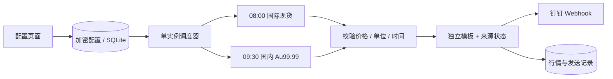
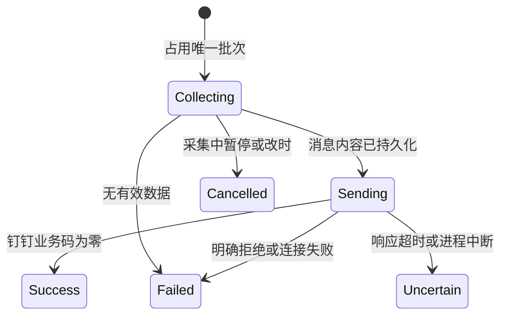

# Gold Watch · 金价观察

部署在自己服务器上的金价简报与配置台。每天北京时间 **08:00 推送国际现货黄金**，**09:30 推送国内 Au99.99**，帮助观察购入实物金条的参考价格。两份简报独立开关、时间、模板与观察目标，发送到钉钉自定义机器人。

Python 3.12 + FastAPI + SQLite + 原生 HTML/CSS/JS；一个 Docker 容器即可运行，无需 Redis、外部数据库或前端构建工具。

## 功能

- 国际、国内两类消息模板独立编辑；可配置观察目标和国内金条手动加价估算。
- 简报突出价格、比较基准和目标差距；未配置的目标及加价自动省略，批次号仅保留在后台记录。
- 国际简报同时显示美元/金衡盎司和人民币/克，附美元兑人民币参考汇率、汇率更新时间及来源。
- 配置台展示最近 7 个北京时间自然日的价格采样折线图；群消息附趋势摘要和实际数据覆盖天数。
- 网页配置台：暂停全部定时任务、分别开关、修改时间、切换来源、配置机器人、预览、手动推送及查看结果。
- 每次发送钉钉消息均 @所有人，定时与手动推送统一生效，不依赖消息模板。
- 默认免密钥行情源，支持切换为带 API Key 的供应商。
- 每条消息保留单位、上游更新时间、来源与简短数据状态；备用收盘价、本地缓存都会明确标注，采集异常原因保留在消息底部。
- SQLite 持久化、任务批次去重、启动恢复、有限补发窗口、单实例锁。
- Basic 登录、配置密钥加密、请求来源保护、默认仅绑定服务器回环地址。

## 在 CentOS + Docker 上部署

需要 Docker Engine 和 Compose 插件（`docker compose version`）。CentOS 只运行容器，不需要宿主机安装 Python 依赖。项目当前仅支持单实例、单 Uvicorn worker。

```bash
git clone https://github.com/bufferducky/gold-watch.git
cd gold-watch

# 自动生成 .env、登录密码和加密密钥；不向终端打印密码。
python3 scripts/setup.py

# 若服务器没有 python3，也可以用 Docker 执行同一初始化脚本：
# docker run --rm --user "$(id -u):$(id -g)" -v "$PWD:/work:Z" -w /work python:3.12-slim python scripts/setup.py

docker compose up -d --build
docker compose ps
```

初始化脚本不会覆盖已有 `.env`。登录用户默认 `admin`，密码在服务器 `.env` 的 `ADMIN_PASSWORD` 字段。该文件权限为 `600`，不要提交到 Git。

默认地址为服务器上的 `http://127.0.0.1:8080`。在自己的电脑建立 SSH 隧道后，用浏览器打开 [本地配置台](http://127.0.0.1:8080)：

```bash
ssh -N -L 8080:127.0.0.1:8080 你的用户名@服务器地址
```

需要通过域名访问时，保留回环绑定，由已有的 Nginx/Caddy 提供 HTTPS 反向代理。Basic 登录的密码必须通过 HTTPS 或 SSH 隧道传输。

首次进入后：

1. 在「推送与配置」填写钉钉 Webhook 和可选的 `SEC…` 加签密钥，保存。
2. 在「行情总览」分别点击「刷新并预览」，核对价格、单位和报价时间。预览不发送消息。
3. 点击「立即推送」实际发送一份消息，核对群内效果和发送记录。
4. 点击「开启定时推送」。首次启动默认为暂停，防止配置未完成时触发任务。

机器人若同时设置了关键词校验，两个模板都必须包含该关键词。签名算法参考[钉钉官方说明](https://open.dingtalk.com/document/orgapp/customize-robot-security-settings)。

## 数据源与价格口径

| 用途 | 来源 | 说明 |
| --- | --- | --- |
| 国际默认源 | [Gold API](https://gold-api.com/docs) | 免费现货聚合参考价，XAU/USD，美元/金衡盎司。上游更新时间不一定等于最后成交时间。 |
| 人民币换算汇率 | [ExchangeRate-API](https://www.exchangerate-api.com/docs/free) | 免密钥、每日更新的 USD/CNY 参考汇率，非实时外汇成交价；在来源下次更新前复用本地缓存。 |
| 国际可选源 | [GoldAPI.io](https://www.goldapi.io/) | 需要 API Key；保存供应商给出的报价源名称、单位、时间戳和昨收。额度与延迟以其套餐为准。 |
| 国内默认源 | [新浪财经](https://finance.sina.com.cn/futures/quotes/AU9999.shtml) | Au99.99，人民币/克；免费公开延时接口，非上金所官方接口，没有可用性保证。 |
| 国内可选源 | [东方财富](https://quote.eastmoney.com/globalfuture/AU9999.html) | 同合约延时行情；开发实测中有直接断连情况，程序会进行有限重试。 |
| 国内可选源 | [聚合数据](https://www.juhe.cn/docs/api/id/29) | 需要开通黄金行情 API Key；按供应商返回的 Au99.99 报价和时间展示。 |
| 国内备用/可选源 | [上金所官方每日行情](https://www.sge.com.cn/sjzx/quotation_daily_new) | 最近完整交易日收盘价。它是历史参考，不替代当前盘中价。 |

国际默认源、国内新浪行情已通过程序真实读取验证。官方每日行情曾通过网页读取验证，但部分程序请求会返回 403；东方财富实测有直接断连。收费来源只按公开字段文档实现并通过模拟响应测试，需要填写自己的 Key 后联调。免费接口可能改版、限流或中断。公开网站可浏览不等于拥有稳定的程序接口，长期对时效要求更高时应选有明确服务约定的数据供应商。

国际报价来自场外市场，不同供应商的买卖价、中间价、最新价可能有差异。不要把不同来源直接拼接成一条连续价格序列；程序只对同来源、同品种、同单位、同价格类型计算历史比较。

### 为什么国内简报默认 09:30

[上金所产品说明](https://www.sge.com.cn/cpfw/Product_service)列出的 Au99.99 正常交易时段为日间 09:00–15:30、夜间 20:00–次日 02:30，节假日以交易所公告为准。09:30 给日盘和延时行情留出更新时间，但仍需核对每次返回的报价时间。

上金所每日行情包含相关夜盘和日盘，交易日期不能直接从自然日期推导。免费国内盘中接口未明确提供交易日期时，程序只展示实际报价时间，不自行猜测交易日。

每天两次任务包含周末和假期。数据超过 20 分钟时标为最近有效报价并提示核对休市/延迟；这一阈值是保守提示，不代表“超过就错误”。周末即使上游更新时间很新，也只标为周末参考。当前版本不内置完整交易所节假日日历，也不保证免费源在市场开放时一定及时。

### 买实物金条时怎么参考

国际简报用于观察国际价格；国内简报的 Au99.99 是市场基准，不是银行或商家的金条销售价。可在配置台手动设置销售加价，得到 `Au99.99 + 手动加价` 的粗略成本估算。它不包含所有费用，也不是实际商家报价。

国际简报在美元报价下方显示人民币换算参考价：`美元/金衡盎司 × USD/CNY ÷ 31.1034768 = 人民币/克`。金衡盎司使用精确的克重换算，人民币结果保留两位小数，计算过程使用 Decimal。换算价不等于国内 Au99.99 或金条销售价。

国际观察目标支持选择「美元/金衡盎司」或「人民币/克」。例如希望观察换算价是否达到 800 元/克，在「推送与配置」的国际简报中，将观察目标单位选为「人民币/克」，目标填写 `800` 后保存。系统每次使用当前报价及对应汇率快照计算人民币/克，与 800 比较，金额差距也显示为元/克，不计商家加价；配置台与消息使用同一套判断结果。判断使用未四舍五入的 Decimal 换算值，显示保留两位小数。没有有效汇率时明确提示「汇率不可用，暂无法判断是否达到目标」，不会把美元报价与人民币目标直接比较。升级前已保存的目标仍按原报价单位解释；切换单位只改变输入金额的单位，不自动改写金额。国内目标继续按 Au99.99 的元/克报价比较。

汇率随黄金报价保存快照，展示来源和独立更新时间，不会把日更汇率称作实时汇率。汇率刷新失败时，若允许回退，可使用不超过 7 天的有效缓存并标明；汇率超过 48 小时或金价与汇率时间相差超过 48 小时时额外提示。没有有效汇率时保留美元报价，明确显示「人民币换算暂不可用」，不填零、不使用固定汇率。

观察目标达到时，简报里会标明，仍保留数据状态和报价时间。该功能只做信息整理，不执行购买、不预测涨跌，不把历史收盘价或换算价当成可成交价。

设置观察目标后，同时显示与目标价的金额差距及百分比，百分比以目标价为基准。例如参考价为 3876.40、目标价为 3800 时，显示「距观察目标还差 76.40 美元/金衡盎司，约 2.01%（以目标价为基准）」。达到或低于目标时改为对应状态。未设置目标或金条手动加价时，消息自动省略对应行。

### 最近 7 天的趋势

「行情总览」分别展示国际、国内最近 7 个北京时间自然日（含今天）的折线图，每天取同来源、同品种、同币种、同单位、同价格类型的最后一条本地采集报价。点选、悬停或键盘聚焦数据点可查看日期和价格，也可展开每日数据表。缺失日期留空并断开连线；切换来源不会拼接旧来源行情。

群消息中的 `{trend}` 展示第一个与最后一个有效日采样之间的金额、百分比变化、实际比较日期及覆盖天数。少于两天时只显示「数据积累中」。图中的日采样范围是这些每日最后一条记录的范围，并非市场盘中最高/最低价。

行情仅在刷新预览或推送时采集，不额外请求行情历史接口。已有本地记录立即可用；若刚部署、长时间停机或切换来源，数据可能不足一周，不会补造历史或按零值填充。群消息不依赖公开图片地址或图床。

## 调度、重启与失败处理

配置台与调度器共享同一份持久化配置，修改后下一个轮询周期生效。每 10 秒检查一次到期任务，到期后采集并发送，因此不承诺恰好在 `08:00:00` 到达。黄金采集链有 65 秒截止时间，国际报价的汇率采集额外最多 8 秒；请求有连接/读取超时，网络错误及 429/5xx 最多尝试 3 次。国内和国际任务各自执行，某一来源失败不会禁用另一任务。



行情源失败时，可选择允许备用源和历史缓存。国际付费源可回退为默认免费源；国内其他盘中源先尝试新浪（已选新浪时不重复），再尝试上金所官方历史收盘；仍失败时可用本地最近有效记录。回退会附上原因、真实来源和原报价时间。没有有效数据就记录失败，不构造价格、不填零。

同一任务、同一计划时间拥有唯一批次。服务在默认 30 分钟补发窗口内重启时，会尝试处理未记录的到期批次；超过窗口不自动补发，避免恢复后集中发送旧简报。暂停期间跨过的时间点若仍在窗口内，重新开启也可能立即执行。修改到另一个计划时间会产生新批次。



钉钉 Webhook 没有本项目可用的严格幂等确认机制。发送中的连接中断、5xx 或无法解析的响应标为「结果不确定」，不会自动重发；启动时遗留的发送中记录也按此处理。已失败的批次不会在每次轮询时重复尝试；核对群消息后可手动创建新批次发送。这样优先避免重复刷屏，不能承诺网络异常下严格只发送一次。

## 配置与模板

`.env` 只保存启动所需参数；两个任务、数据源和机器人设置均在页面修改并保存到 SQLite。

| 环境变量 | 默认值 / 用途 |
| --- | --- |
| `ADMIN_USERNAME` | `admin` |
| `ADMIN_PASSWORD` | 初始化脚本随机生成，至少 16 位 |
| `APP_ENCRYPTION_KEY` | Fernet 加密密钥，初始化脚本生成，必须长期保留 |
| `BIND_ADDRESS` | `127.0.0.1`，Compose 发布地址 |
| `PORT` | `8080`，宿主机端口 |
| `TZ` | `Asia/Shanghai`；任务逻辑也显式固定为北京时间 |
| `DATA_DIR` | 容器内 `/app/data` |

Webhook、签名密钥、行情 API Key 在数据库中加密。页面/API 不回显这些字段，留空保留原值；勾选清除可删除钉钉字段。更换 `APP_ENCRYPTION_KEY` 会导致已有配置无法解密，所以备份时必须同时保存 `.env`。

两份 Markdown 模板支持以下简单变量，不支持代码、属性访问或格式表达式：

`{title}` `{conversion}` `{price}` `{unit}` `{name}` `{date}` `{quote_time}` `{source}` `{source_url}` `{status}` `{change}` `{previous}` `{target}` `{premium}` `{trend}` `{warnings}` `{note}`

`{conversion}` 为人民币/克换算价及汇率说明，默认紧跟美元报价。国际自定义模板如未包含该变量，消息末尾会补充，确保保留换算结果或汇率不可用提示；国内简报中为空。

`{change}` 优先使用当前来源上一交易日收盘；没有该数据时使用上一份同口径成功推送的报价快照，并明确标注基准时间。刷新预览、失败或结果不确定的发送不会改变比较基准。旧版本发送记录没有报价快照，升级后需积累首份成功推送才可使用此类基准。

`{title}` 在默认早报手动推送或定时推送时间为中午及以后时使用「国际金价观察」；早间定时推送使用「国际金价早报」，自定义标题保留。`{quote_time}` 精简为月日、时分和北京时间，跨年报价保留年份。删除来源、时间、单位、状态或数据提示变量后，程序会在消息末尾补充对应信息。

升级时自动识别并替换未修改过的旧默认模板及默认备注，自定义模板和备注保留。自定义模板如需展示趋势摘要，可自行加入 `{trend}`。发送批次号仍保存在后台记录中，不再附到群消息正文。

## 日常运维

```bash
# 状态与日志（日志已禁用行情请求 URL，避免泄漏 token）
docker compose ps
docker compose logs --tail=100 gold-watch
curl --fail http://127.0.0.1:8080/healthz

# 更新代码，保留 .env 与数据卷
git pull --ff-only
docker compose up -d --build

# 停止；再次 up 会沿用原配置
docker compose down
```

`/healthz` 检查数据库可访问、调度循环未停止且最近心跳未超过 180 秒，不依赖外部行情源。Docker 健康状态可用于外部监控；`restart: unless-stopped` 负责进程退出后重启，**不会仅因 unhealthy 状态自动重启**。外部监控还应检查预期时间之后是否有成功发送记录，避免只检查进程存在。

行情与推送记录默认保留 365 天，页面显示最近 40 条发送记录。Docker 日志轮转为每份 10 MB、3 份。

### 备份与恢复

备份前暂停容器，避免直接拷贝运行中的 SQLite WAL 文件产生不完整快照：

```bash
mkdir -p backup
chmod 700 backup
docker compose stop gold-watch
docker compose cp gold-watch:/app/data/gold-watch.db backup/gold-watch.db
cp .env backup/gold-watch.env
chmod 600 backup/*
docker compose start gold-watch
```

恢复时先保留对应的加密密钥，停止容器，再将备份数据库拷回 `/app/data/gold-watch.db`。保证文件对容器用户 UID 10001 可读写；原数据卷中的旧 `-wal`、`-shm` 文件不能与另一份数据库混用。完整迁移建议在新数据卷恢复，不要直接覆盖运行中的数据库。

不要使用 `docker compose down -v`，除非确实要删除所有持久化配置和记录。

## 本地开发与验证

```bash
python3 -m venv .venv
.venv/bin/pip install -r requirements.lock
.venv/bin/pip install -e '.[dev]'
python3 scripts/setup.py

# 仅在本地加载自己生成、可信的 .env
set -a
. ./.env
set +a
.venv/bin/uvicorn gold_watch.app:app --host 127.0.0.1 --port 8080 --workers 1 --no-access-log

# 另一个终端
.venv/bin/pytest -q
.venv/bin/ruff check .
node --check gold_watch/static/app.js
npm ci
npm test
```

自动测试使用模拟行情和模拟钉钉响应，不发送真实消息。覆盖价格精度、占位零值、时间/币种校验、历史收盘回退、任务去重、重启和发送不确定状态、暂停、签名、模板变量限制、登录与密钥脱敏。页面交互测试使用 Node.js 22.12+ 和 jsdom，覆盖配置保存、后台刷新不覆盖未保存修改、消息预览及 Basic 登录 URL 的兼容性；Node.js 仅用于开发测试，服务器运行不需要安装。

API：`GET /api/state`、`PUT /api/settings`、`POST /api/preview/{international|domestic}`、`POST /api/send/{international|domestic}`。除 `/healthz` 和静态资源外均需 Basic 登录；写请求需携带 `X-Gold-Watch: 1`，不开放跨域。

## 项目结构

```text
gold_watch/
  app.py          # 登录、配置 API、健康检查与单实例生命周期
  models.py       # 配置、报价、模板变量与时间校验
  providers.py    # 数据源适配、请求重试与来源回退
  store.py        # SQLite、加密配置、行情和任务批次
  service.py      # 调度、采集、恢复及发送状态
  reports.py      # 两类消息渲染、钉钉签名与发送
  trends.py       # 同口径近7日采样、缺失日期与趋势摘要
  currency.py     # 金衡盎司转克、人民币换算与汇率时效提示
  targets.py      # 原币种或人民币/克目标判断与金额差距
  static/         # 不依赖 CDN 的响应式配置台
tests/            # 离线测试
scripts/setup.py  # 不覆盖已有配置的密钥初始化
```

## License

MIT。
